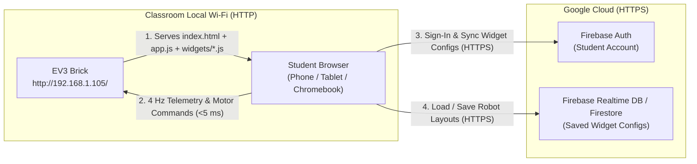

# Firebase Cloud Config & Classroom Multi-User Plan

## 1. Goal & Classroom Scenario

In a classroom or workshop with many students, each student builds their own LEGO Mindstorms EV3 robot and connects to it over Wi-Fi (`http://192.168.x.x/`).

We want:
1. **Fast, reliable local robot control:** Motor and sensor commands (`POST /api/batch`, `GET /api/status`) stay 100% on the local Wi-Fi network between the student's browser and their EV3 brick, with zero cloud lag and zero extra CPU or RAM load on the 300 MHz / 64 MB EV3.
2. **Cloud-synced widget configurations per student account:** Each student can sign in on their phone, tablet, or Chromebook and have their custom dashboard layouts, port mappings, and widget settings saved to their Firebase account.
3. **Offline resilience:** If the classroom router has no internet connection (or if a student does not sign in), the dashboard still works using browser `localStorage` and the EV3's local `web_assets/` widgets.

---

## 2. Core Architecture: Why the EV3 Serves the Page and the Browser Talks to Firebase



### Architectural Decisions & Cross-Origin Rules

- **`[ADOPTED]` Serve the Web App from `http://<ev3-ip>/` and Call Firebase (`https://`) from Browser JS:**
  - **Why this works with browser security:**
    1. **No Mixed Content Block:** Browsers block an `https://` page from making `fetch()` calls to an insecure `http://` server. They **allow** an `http://` page to make `fetch()` or WebSocket calls to an `https://` API (upgrading from HTTP to HTTPS is always permitted).
    2. **Same-Origin Motor Control:** Because the page origin is `http://<ev3-ip>`, all `POST /api/batch` and `POST /api/port/*` motor requests are same-origin. They pass the CSRF `Origin == Host` check in [`src/web.rs`](src/web.rs) without needing permissive CORS headers.
    3. **Firebase CORS Support:** Firebase Auth (`https://identitytoolkit.googleapis.com`) and Firebase Realtime Database / Firestore (`https://*.firebaseio.com`, `https://firestore.googleapis.com`) include `Access-Control-Allow-Origin: *` (or echo the caller's `Origin` header) on all responses. They accept requests from any `http://192.168.x.x` origin.
    4. **Zero EV3 Hardware Overhead:** The EV3 never opens a TLS connection to Firebase, never parses cloud JSON, and never allocates RAM for cloud state.

- **`[REJECTED]` Hosting the Dashboard on Firebase Hosting (`https://<project>.web.app`) and Calling `http://<ev3-ip>/`:**
  - **Why it fails:** Modern Chrome, Edge, and Safari block `https://` pages from sending `fetch()` requests to `http://192.168.x.x` due to **Mixed Content** rules and **Private Network Access (PNA)** preflight checks. In addition, opening the EV3 to cross-origin `POST` requests (`Access-Control-Allow-Origin: *`) was rejected in `BUG-30` because any external website could drive the robot.

---

## 3. The Tricky Cross-Origin & Authentication Problem on Dynamic LAN IPs

### 3.1 Trap: Why `signInWithPopup` / `signInWithRedirect` Fails on `http://192.168.x.x`

If a student opens `http://192.168.1.105/` and the app calls Firebase's `signInWithPopup(auth, new GoogleAuthProvider())` or `signInWithRedirect(...)`:
- Firebase checks whether `192.168.1.105` is listed in **Firebase Console $\rightarrow$ Authentication $\rightarrow$ Settings $\rightarrow$ Authorized Domains**.
- Firebase and Google OAuth **do not allow wildcard private IP ranges** (such as `192.168.1.*` or `10.0.0.*`).
- Every time DHCP assigns a new IP address to an EV3 brick in a classroom, OAuth popups and redirects will fail with `FirebaseError: Firebase: Error (auth/unauthorized-domain)`.

### 3.2 How to Solve Student Sign-In on Any EV3 IP Address

Firebase only enforces the `Authorized Domains` whitelist on **OAuth redirect/popup flows** (`signInWithPopup`, `signInWithRedirect`, `sendSignInLinkToEmail`). Direct credential API calls (`signInWithEmailAndPassword`, `createUserWithEmailAndPassword`, and `signInWithCustomToken`) go directly to `https://identitytoolkit.googleapis.com/v1/accounts:signInWithPassword` over CORS and **work from any `http://192.168.x.x` IP address without domain registration**.

This gives us two clean authentication options depending on how the classroom is run:

#### Option A `[ADOPTED - Primary Classroom Mode]`: "Builder Name + Secret PIN" (Synthetic Email/Password Auth)

Most kids in a robotics workshop do not want to type a full email address, verify an inbox, or deal with blocked OAuth popups.

- **How the Student Signs In:**
  1. The student taps the **"Cloud Sync / Sign In"** button in the top bar of [`index.html`](web_assets/index.html).
  2. A modal asks for two simple fields:
     - **Builder Username:** e.g. `alex_bot` (letters, numbers, underscores)
     - **6-Digit Secret PIN (or Password):** e.g. `482910`
  3. Two buttons: **[ Sign In ]** and **[ New Builder (Create) ]**.
- **What Happens Under the Hood:**
  - [`app.js`](web_assets/app.js) normalizes the Builder Username (`alex_bot` $\rightarrow$ `alex_bot@ev3-classroom.local`) and calls Firebase Auth's `signInWithEmailAndPassword(auth, "alex_bot@ev3-classroom.local", pin)` (or `createUserWithEmailAndPassword` when creating a new account).
  - Because `signInWithEmailAndPassword` uses a direct HTTPS POST to `identitytoolkit.googleapis.com` instead of an OAuth redirect, **it works from every `http://192.168.x.x` EV3 IP address with zero Firebase Console IP setup**.
  - Firebase Auth returns a real `uid` and signed JWT ID token.

#### Option B `[ALTERNATIVE - Optional Google Sign-In via Hosted Auth Bridge]`:

If students must sign in with real Google Classroom accounts:
1. Host a tiny 30-line static login page on Firebase Hosting (`https://<project>.web.app/login.html`), which is on Firebase's default Authorized Domains list.
2. When a student on `http://192.168.1.105/` clicks **"Sign in with Google"**, [`app.js`](web_assets/app.js) opens `https://<project>.web.app/login.html?origin=http://192.168.1.105` in a popup (`window.open`).
3. The student completes Google Sign-In on the `https://<project>.web.app` popup.
4. The popup sends the Google OAuth `idToken` back to the EV3 tab using `window.opener.postMessage({ googleIdToken }, "http://192.168.1.105")` and closes itself.
5. The EV3 tab (`http://192.168.1.105/`) passes that token directly to `signInWithCredential(auth, GoogleAuthProvider.credential(googleIdToken))`—which is a direct POST call that bypasses the `Authorized Domains` check on the EV3's IP!

### 3.3 Per-Origin Browser Storage Quirk (`http://192.168.1.101` vs `http://192.168.1.102`)

- Browser `localStorage` and `IndexedDB` (where Firebase caches the signed-in session) are isolated per URL origin (`http://192.168.1.101` has separate storage from `http://192.168.1.102`).
- **What this means in practice:**
  - As long as a student connects to **their own robot** (`http://192.168.1.101`), their tablet/laptop remembers their Firebase login across page reloads and reboots.
  - If a student switches to a **different robot IP** (`http://192.168.1.102`), they simply enter their Builder Username + PIN once on the new IP, and their saved widget configs download immediately from Firebase.

---

## 4. Database Schema & Security Rules

We can use **Firebase Realtime Database (RTDB)** or **Cloud Firestore**. Firebase Realtime Database is ideal here because a student's entire dashboard config is a small JSON object (< 4 KB), and RTDB's JS SDK is tiny and supports instant JSON tree sync.

### 4.1 JSON Schema in Firebase Realtime Database

```json
{
  "users": {
    "<uid>": {
      "username": "alex_bot",
      "activeBotId": "bot_main",
      "bots": {
        "bot_main": {
          "name": "Claw Bot",
          "updatedAt": 1728675000000,
          "widgets": [
            {
              "id": "w_1",
              "type": "joystick",
              "xPort": "B",
              "yPort": "C"
            },
            {
              "id": "w_2",
              "type": "button",
              "port": "A",
              "speed": 600
            },
            {
              "id": "w_3",
              "type": "sensor",
              "port": "1",
              "mode": "COL-COLOR"
            }
          ]
        },
        "bot_sumo": {
          "name": "Sumo Pusher",
          "updatedAt": 1728672000000,
          "widgets": []
        }
      }
    }
  }
}
```

### 4.2 Why Multiple Named Bot Profiles (`bots/<botId>`) Help in a Classroom

A kid often builds a Claw Bot in Week 1 and a Sumo Bot in Week 2, or shares a robot chassis with a partner. Storing a dropdown of named bot profiles (`"Claw Bot"`, `"Sumo Pusher"`) inside `/users/<uid>/bots` lets them switch between saved dashboard layouts in one tap without losing their old setup.

### 4.3 Firebase Security Rules (`database.rules.json`)

To make sure students in a classroom cannot overwrite or delete each other's configurations, lock `/users/$uid` to the authenticated owner:

```json
{
  "rules": {
    "users": {
      "$uid": {
        ".read": "auth != null && auth.uid === $uid",
        ".write": "auth != null && auth.uid === $uid",
        ".validate": "newData.hasChildren(['username', 'bots'])"
      }
    }
  }
}
```

---

## 5. Offline-First Sync Flow in `web_assets/app.js`

Because the EV3 is an embedded appliance, **the web UI must never break or hang if the classroom has no internet access**.

### 5.1 Dynamic SDK Loading (Non-Blocking)

Do **not** put blocking `<script src="https://www.gstatic.com/...">` tags in `<head>` of [`web_assets/index.html`](web_assets/index.html). If the EV3 is on an offline router with no internet, a blocking `<script>` tag in `<head>` will hang page rendering for 30+ seconds while the browser waits for `gstatic.com` to time out!

Instead, load Firebase asynchronously inside [`web_assets/app.js`](web_assets/app.js) after the local dashboard is already rendered from `localStorage`:

```javascript
async initFirebaseCloudSync() {
    try {
        // Dynamically import Firebase modular ESM SDK from CDN only after local UI is interactive
        const [{ initializeApp }, { getAuth, onAuthStateChanged, signInWithEmailAndPassword, createUserWithEmailAndPassword, signOut }, { getDatabase, ref, onValue, set }] = await Promise.all([
            import("https://www.gstatic.com/firebasejs/10.14.1/firebase-app.js"),
            import("https://www.gstatic.com/firebasejs/10.14.1/firebase-auth.js"),
            import("https://www.gstatic.com/firebasejs/10.14.1/firebase-database.js")
        ]);
        // Initialize app and attach auth listener...
    } catch (err) {
        // Offline / LAN-only mode: keep Cloud badge as "Offline (Local Only)" and use localStorage
        console.warn("[CLOUD] Internet unreachable; running in local-only mode:", err);
    }
}
```

### 5.2 Conflict Resolution (`localStorage` $\leftrightarrow$ Firebase)

1. **On Page Load (`http://<ev3-ip>/`):**
   - Immediately render the dashboard from `localStorage.getItem("ev3_dashboard_widgets")` so the UI appears in < 50 ms.
   - Start `initFirebaseCloudSync()` in the background.
2. **When Signed In (`onAuthStateChanged` fires with `user`):**
   - Subscribe to `/users/${user.uid}/bots/${activeBotId}` in Firebase.
   - If a cloud config exists and its `updatedAt` timestamp is newer than the local `updatedAt`, update `localStorage` and re-render the dashboard tiles.
   - If the student had already configured tiles locally before signing in (and the cloud account is brand new), upload the current local tiles to Firebase so they do not lose work they did before logging in.
3. **Whenever the Student Adds, Edits, Reorders, or Deletes a Widget Tile:**
   - Save to `localStorage` immediately with `updatedAt = Date.now()`.
   - If signed in to Firebase, write `{ name, updatedAt, widgets }` to `/users/${user.uid}/bots/${activeBotId}` in the background.

---

## 6. Step-by-Step Implementation Checklist

### Step 1: Firebase Project Setup (One-Time Teacher/Admin Setup)
- [ ] Create a free Firebase project at `https://console.firebase.google.com/`.
- [ ] Enable **Authentication $\rightarrow$ Sign-in method $\rightarrow$ Email/Password** (no Email Link needed).
- [ ] Enable **Realtime Database** and paste the `database.rules.json` security rules from Section 4.3.
- [ ] Copy the public `firebaseConfig` object (`apiKey`, `authDomain`, `databaseURL`, `projectId`). *(Note: Firebase web `apiKey` values are public project identifiers by design; security is enforced by `database.rules.json`.)*

### Step 2: Browser Cloud Sync Module (`web_assets/app.js` & `web_assets/index.html`)
- [ ] Add a compact **Cloud / Builder Account** pill button in the top bar of [`web_assets/index.html`](web_assets/index.html) showing:
  - `Sign In` (when logged out)
  - `Builder: <username> ▾` with a bot profile switcher (`Claw Bot`, `Sumo Bot`, `+ New Bot`) when logged in
  - `Local Mode` (when offline)
- [ ] Add a clean Sign-In / Create-Builder modal in [`web_assets/index.html`](web_assets/index.html) taking **Builder Username** + **6-Digit PIN**.
- [ ] Implement `initFirebaseCloudSync()`, `signInBuilder(username, pin, isNew)`, and `syncConfigToCloud()` in [`web_assets/app.js`](web_assets/app.js) using dynamic ESM imports so offline classrooms never hang on startup.
- [ ] Add `updatedAt` timestamps to the dashboard config object in [`web_assets/app.js`](web_assets/app.js) so the newest config wins when syncing between `localStorage` and Firebase.

### Step 3: Host Simulation Verification (Rule 4)
- [ ] Run `cargo run -- --mock` on `http://localhost:8080/`.
- [ ] Test creating two different student accounts (`student1` and `student2`), saving different widget layouts, switching accounts, and verifying each student's layout loads cleanly.
- [ ] Test blocking `gstatic.com` in browser DevTools (simulating an offline classroom router) and verify that `http://localhost:8080/` still loads immediately and saves widget configs to `localStorage`.
