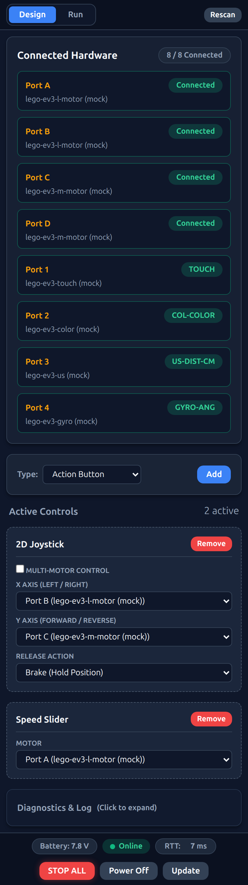
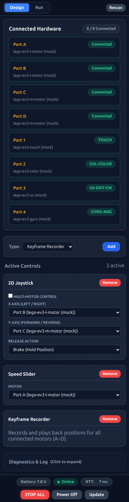
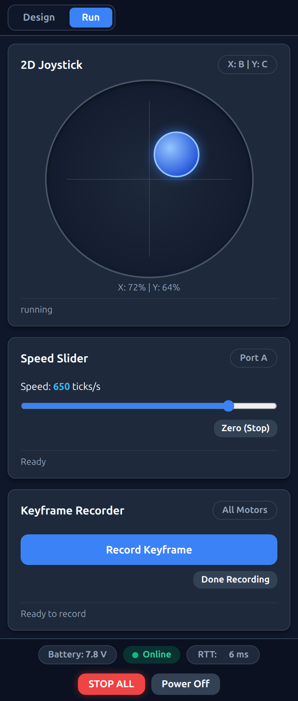
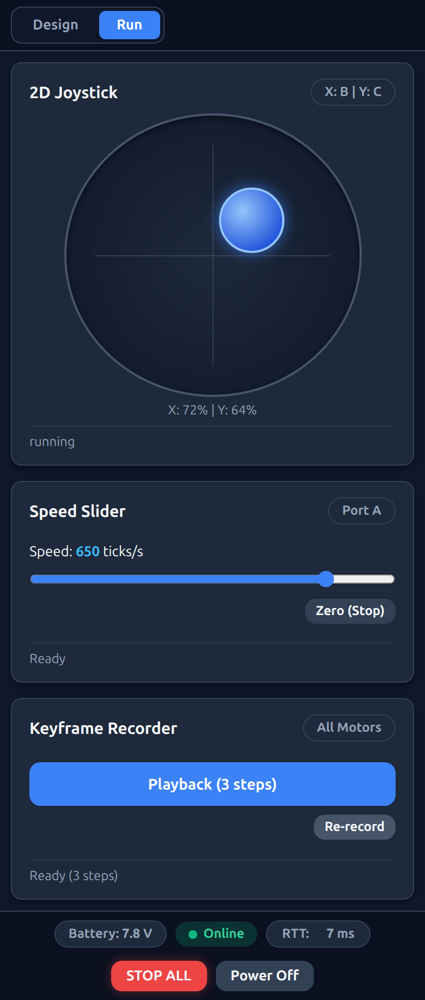

# LEGO Mindstorms EV3 Web Motor Control

A lightweight web dashboard and REST API written in Rust for the LEGO Mindstorms EV3 (Texas Instruments Sitara AM1808, ARMv5te @ 300 MHz, 64 MB RAM).

Control EV3 motors and sensors from any phone, tablet, or desktop browser over Wi-Fi or USB.

---

### Mobile Workflow Walkthrough (Portrait 390×844)

| 1. Check for Updates | 2. Add Widgets | 3. Move & Drive | 4. Record Keyframes | 5. Playback Steps |
| :---: | :---: | :---: | :---: | :---: |
|  |  |  |  |  |
| **Design View:** Sync widgets from GitHub and inspect connected hardware. | **Configure Layout:** Add 2D Joystick, Speed Slider, and Keyframe Recorder. | **Run View:** Drive motors in real time with touch controls. | **Keyframe Recorder:** Capture live motor positions across all ports (`A`–`D`). | **Autonomous Playback:** Replay recorded positions sequentially with stall recovery. |

---

## Quickstart

### 1. Host Simulation (No EV3 Hardware Required)
Test the web interface, touch widgets, and simulated motors and sensors on your computer:
```bash
cargo run -- --mock
# Open http://localhost:8080/ in your browser
```

### 2. Standalone Appliance Setup (1-Click Bake & Flash)
Create a git-ignored `wifi.txt` file in the repository root with your Wi-Fi network name on line 1 and password on line 2:
```text
<SSID>
<PASSWORD>
```
Insert a MicroSD card and run:
```bash
sudo ./tools/flash-image.sh -y
```
`flash-image.sh` runs `bake-image.sh` (using `wifi.txt`), generates a `.bmap` block map, detects your removable MicroSD card, flashes allocated blocks with `bmaptool`, and verifies the installation. Insert the card and a compatible USB Wi-Fi dongle into the EV3 brick to boot directly to the dashboard URL (`http://<ip>/`).

---

## Key Features

- **Modular Control Widgets:** Touch-friendly 2D Joystick, dual-track Tank controls, Speed Slider, Action Button, Sensor display, and Keyframe Recorder (`web_assets/widgets/*.js`).
- **Dynamic Discovery & On-Demand GitHub Sync:** The server scans `web_assets/widgets/*.js` via `GET /api/widgets` and syncs new or updated widgets from GitHub via the Design View **Update** button (`POST /update`).
- **Keyframe Recorder & Playback:** Record encoder positions across all connected motors (`A`–`D`) and play them back sequentially at maximum speed with 1-second stall recovery.
- **Non-Blocking Telemetry:** A background thread polls Linux sysfs every 50 ms and updates an in-memory cache. HTTP requests (`GET /api/status`) read directly from RAM without blocking on disk I/O.
- **Unified Safety Watchdog:** Automatically coasts all motors if client communication stops for more than 2,000 ms.
- **On-Brick LCD Status Display:** Native 7-row console renderer on `/dev/tty1` showing live IP address, battery voltage, and motor status.
- **Low Resource Usage:** Statically linked `armv5te-unknown-linux-musleabi` binary targeting < 3 MB RAM RSS.

---

## Documentation Guides

- **[Appliance Setup Guide](docs/setup.md):** Image baking (`tools/bake-image.sh`), MicroSD flashing (`tools/flash-image.sh`), Wi-Fi dongle compatibility, and first boot.
- **[Development & Deployment Guide](docs/development.md):** Cross-compilation toolchain, host simulation, USB networking, and SSH deployment.
- **[System Architecture Guide](docs/architecture.md):** Runtime memory model, non-blocking sysfs polling, safety watchdog, and modular widget pipeline.
- **[REST API Reference](docs/api.md):** Complete JSON REST API reference, batch motor commands, and widget endpoints.

---

## Project Structure

```
ev3_next/
├── Cargo.toml               # Cargo package configuration
├── ev3-web.service          # Systemd unit file for auto-start on boot
├── docs/                    # Technical guides and workflow screenshots
├── tools/                   # Appliance automation scripts (bake-image.sh, flash-image.sh)
├── src/                     # Rust server source (web.rs, controller.rs, updater.rs, sysfs/)
└── web_assets/              # Web dashboard (index.html, style.css, app.js, widgets/*.js)
```

---

## License
MIT / Apache 2.0
